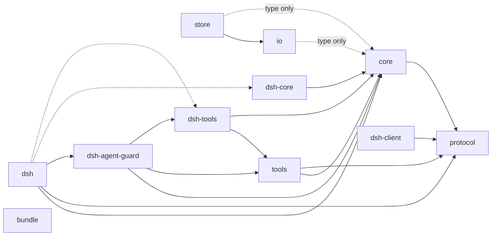

# taskboard3 分包与依赖

> 基线：tag [`pkg-review-2026-11-27`](https://github.com/zms9110750/taskboard3/tree/pkg-review-2026-11-27)
>
> 本文描述现状与可选方案。标「待定」的是需要用户决定的，不是已实施。

## 1. 总览

| 包 | 一句话职责 | 运行时依赖 | 仅类型依赖 | DI | 可替换 |
|---|---|---|---|---|---|
| [`protocol`](https://github.com/zms9110750/taskboard3/tree/pkg-review-2026-11-27/packages/protocol) | 9 状态 / 4 组 / 6 关系 / 错误码 / 转移判定表 | 无 | 无 | 无 | 包级 |
| [`core`](https://github.com/zms9110750/taskboard3/tree/pkg-review-2026-11-27/packages/core) | 卡、模板、搜索、状态转移、存储端口、工具档位 | `protocol`、`yaml`、`zod` | — | 端口由宿主注入 | ❌ |
| [`tools`](https://github.com/zms9110750/taskboard3/tree/pkg-review-2026-11-27/packages/tools) | AI 工具定义层（MCP / DSH 通用） | `core`、`protocol` | — | 无（纯库） | ❌ |
| [`io`](https://github.com/zms9110750/taskboard3/tree/pkg-review-2026-11-27/packages/io) | SQLite 封装（卡 + kv） | `node:fs`、`node:path`、`node:sqlite` | `core` 的 `Card` / `CardStore` | 无 | ✅ |
| [`store`](https://github.com/zms9110750/taskboard3/tree/pkg-review-2026-11-27/packages/store) | `provide('taskboard3Store')` 的薄插件 | `io` 的 `createSqliteStore` | `core` 的 `CardStore` | provide + effect | ✅ 插件行 |
| [`dsh-core`](https://github.com/zms9110750/taskboard3/tree/pkg-review-2026-11-27/packages/dsh-core) | 建唯一实例、provide core / bus / 默认空间 | `core` 的 `createTaskboard` / `createBus` | `Bus` / `Taskboard` / `CardStore` | inject store，provide 三个服务 | ❌ |
| [`dsh-tools`](https://github.com/zms9110750/taskboard3/tree/pkg-review-2026-11-27/packages/dsh-tools) | 把 `tools` 注册到 `ctx.tools` | `tools`、`core`、`protocol` | — | inject core / tools | ❌ |
| [`dsh-agent-guard`](https://github.com/zms9110750/taskboard3/tree/pkg-review-2026-11-27/packages/dsh-agent-guard) | agent 工具档位守卫 + `/api/tools` | `core`、`protocol`、`tools`、`dsh-tools` | — | inject core / store / tools | ❌ |
| [`dsh`](https://github.com/zms9110750/taskboard3/tree/pkg-review-2026-11-27/packages/dsh) | HTTP 路由 + 命令 + SSE（临时） | `core`、`protocol`、`dsh-agent-guard` | `dsh-core`、`dsh-tools`（声明了但零 import） | inject 6 个服务 | ❌ |
| [`dsh-client`](https://github.com/zms9110750/taskboard3/tree/pkg-review-2026-11-27/packages/dsh-client) | 浏览器 UI | `protocol`、`react`、`react-dom`、`marked` | 宿主的 slots 类型 | inject slots / sidebarRightTabs | ✅ 插件行 |
| [`bundle`](https://github.com/zms9110750/taskboard3/tree/pkg-review-2026-11-27/packages/bundle) | bundle 壳：`cordis.patch.yml` 6 行装配 | 无 import | 无 | 无 | ✅ 插件行 |

## 2. 依赖图



实线 = 运行时 import；虚线 = 仅类型 / 声明但未使用。

文字版：

```
protocol
  ↑
core ──► tools
  ↑        ↑
  io       dsh-tools ──► dsh-agent-guard ──► dsh
  ↑                         ↑                  ↑
store ──────────────────────┘                  │
                                                │
dsh-client ──► protocol                         │
bundle（不 import，只写 patch 行）──────────────┘
```

## 3. 每个包的对外依赖

### protocol

职责：词汇与判定。9 状态、4 组、6 关系、错误码、按钮矩阵、`judgeTransition`。

对外：**零依赖**。`src/**` 没有跨包 import，`package.json` 没有 dependencies / peerDependencies。

被谁用：core / tools / dsh / dsh-client 都以包名 import。

文件：[status.ts](https://github.com/zms9110750/taskboard3/blob/pkg-review-2026-11-27/packages/protocol/src/status.ts)、[relation.ts](https://github.com/zms9110750/taskboard3/blob/pkg-review-2026-11-27/packages/protocol/src/relation.ts)、[error.ts](https://github.com/zms9110750/taskboard3/blob/pkg-review-2026-11-27/packages/protocol/src/error.ts)、[transition.ts](https://github.com/zms9110750/taskboard3/blob/pkg-review-2026-11-27/packages/protocol/src/transition.ts)。

### core

职责：领域实现。卡、模板加载与校验、搜索、状态转移、`CardStore` 端口、`ToolPolicyStore`、临时 bus。

对外：
- `protocol`：值 + 类型（状态、按钮、错误码）；
- `yaml`、`zod`：模板解析与校验；
- `node:fs` / `node:path` / `node:url`：只在 [`template/builtin.ts`](https://github.com/zms9110750/taskboard3/blob/pkg-review-2026-11-27/packages/core/src/template/builtin.ts)；
- Cordis：**零 import**；`store`、`bus`、`now` 都由构造参数注入。

文件：[index.ts](https://github.com/zms9110750/taskboard3/blob/pkg-review-2026-11-27/packages/core/src/index.ts)、[ports.ts](https://github.com/zms9110750/taskboard3/blob/pkg-review-2026-11-27/packages/core/src/ports.ts)、[bus.ts](https://github.com/zms9110750/taskboard3/blob/pkg-review-2026-11-27/packages/core/src/bus.ts)。

### tools

职责：AI 工具定义层，纯 JSON Schema，不依赖宿主。

对外：`core`（`Taskboard` 类型 + `contentOfCard` 等）、`protocol`（状态词表、错误码、按钮选项）。

**零 Cordis、零总线、零 Node 内置**（`tsconfig` 的 `types: []` 机械保证）。

文件：[index.ts](https://github.com/zms9110750/taskboard3/blob/pkg-review-2026-11-27/packages/tools/src/index.ts)、[tools.ts](https://github.com/zms9110750/taskboard3/blob/pkg-review-2026-11-27/packages/tools/src/tools.ts)。

### io

职责：SQLite 实现，只实现 `CardStore` 端口。

对外：`node:fs` / `node:path` / `node:sqlite`；`core` 只 `import type`。

**零 Cordis、零总线**。

文件：[sqlite.ts](https://github.com/zms9110750/taskboard3/blob/pkg-review-2026-11-27/packages/io/src/sqlite.ts)、[index.ts](https://github.com/zms9110750/taskboard3/blob/pkg-review-2026-11-27/packages/io/src/index.ts)。

### store

职责：把默认 SQLite 实现装成 Cordis 服务。

对外：`io.createSqliteStore`（唯一运行时 import）；`core.CardStore`（类型）；`ctx.provide` / `ctx.effect`（框架实参，不 import）。

文件：[index.ts](https://github.com/zms9110750/taskboard3/blob/pkg-review-2026-11-27/packages/store/src/index.ts)。

### dsh-core

职责：创建唯一 `Taskboard` 实例，provide `taskboard3Core` / `taskboard3Bus` / `taskboard3DefaultWorkspaceId`。

对外：`core` 的 `createTaskboard` / `createBus`；inject `taskboard3Store`。

文件：[index.ts](https://github.com/zms9110750/taskboard3/blob/pkg-review-2026-11-27/packages/dsh-core/src/index.ts)。

### dsh-tools

职责：把 `tools` 注册到 DSH 的工具注册表。

对外：`tools`（`createTaskboardTools` 等）、`core`、`protocol`；inject `taskboard3Core` / `taskboard3DefaultWorkspaceId` / `tools`。

文件：[index.ts](https://github.com/zms9110750/taskboard3/blob/pkg-review-2026-11-27/packages/dsh-tools/src/index.ts)。

### dsh-agent-guard

职责：agent 工具档位守卫、工具清单、`/api/tools`。

对外：`core`（`Taskboard`、判定）、`protocol`、`tools`（结果文本、工具定义）、`dsh-tools`（schema 适配）；inject `taskboard3Core` / `taskboard3Store` / `tools`。

文件：[index.ts](https://github.com/zms9110750/taskboard3/blob/pkg-review-2026-11-27/packages/dsh-agent-guard/src/index.ts)、[permission.ts](https://github.com/zms9110750/taskboard3/blob/pkg-review-2026-11-27/packages/dsh-agent-guard/src/permission.ts)。

### dsh

职责：HTTP 路由、命令、SSE（临时）。

对外：`core`（`Taskboard`、`BASE_TOOLS` 等）、`protocol`、`dsh-agent-guard`（档位读写）；`dsh-core` / `dsh-tools` 在 `package.json` 里声明了但源码零 import。

inject：`webServer`、`connection`、`commands`、`taskboard3Core`、`taskboard3Bus`、`taskboard3Store`；可选 `ctx.get('taskboard3AgentGuard')`。

文件：[http.ts](https://github.com/zms9110750/taskboard3/blob/pkg-review-2026-11-27/packages/dsh/src/http.ts)、[sse.ts](https://github.com/zms9110750/taskboard3/blob/pkg-review-2026-11-27/packages/dsh/src/sse.ts)、[index.ts](https://github.com/zms9110750/taskboard3/blob/pkg-review-2026-11-27/packages/dsh/src/index.ts)。

### dsh-client

职责：浏览器 UI。

对外：`protocol`（词表与按钮表）；`react` / `react-dom` / `marked`；宿主 slots（类型手写）。

测试用 `core` / `io` / `tools`，只在 `test/`。

文件：[client.tsx](https://github.com/zms9110750/taskboard3/blob/pkg-review-2026-11-27/packages/dsh-client/src/client.tsx)、[api.ts](https://github.com/zms9110750/taskboard3/blob/pkg-review-2026-11-27/packages/dsh-client/src/api.ts)、[types.ts](https://github.com/zms9110750/taskboard3/blob/pkg-review-2026-11-27/packages/dsh-client/src/types.ts)。

### bundle

职责：壳。`cordis.patch.yml` 里 6 行 insert；没有运行时代码。

对外：**零 import**；只在 patch 里写包名，由 DSH loader 解析。

文件：[cordis.patch.yml](https://github.com/zms9110750/taskboard3/blob/pkg-review-2026-11-27/packages/bundle/cordis.patch.yml)、[package.json](https://github.com/zms9110750/taskboard3/blob/pkg-review-2026-11-27/packages/bundle/package.json)。

## 4. 如果新建一个纯契约包

假设 `@taskboard/contracts` 只放：

- 接口：`TaskboardPort`、`CardStore`、`Bus`；
- DTO：`Card`、`Workspace`、`Envelope`；
- 常量：服务名、内置 kind / 模板名。

### 会发生什么

| 变化 | 结果 |
|---|---|
| 类型身份 | 只有一份，dsh-client 不再手抄 `Card` / `Workspace` |
| 实现约束 | `class Taskboard implements TaskboardPort` 少一个方法就编译失败 |
| 服务名 | `STORE_SERVICE` 等只写一次，provide / inject 双方共用 |
| 构建 | 多一个必须先构建的包，`tsc -b` 从 10 个变 11 个 |
| 运行时 | 若含常量，则不再是纯类型包；必须浏览器安全（无 Node / zod / yaml） |
| 耦合 | 所有包都依赖它，改一个类型全仓重建 |

### 主要风险

1. **变成第二真值**：contracts 重新定义而不是搬移，结构兼容但语义分叉。
2. **成环**：contracts 一 import core 就循环。
3. **God package**：所有东西都往里塞，最后 9 个包都依赖它。
4. **无强制**：建了包但没人禁止继续从 core 手抄，漂移会回来。

### 成立条件

- contracts 只依赖 `protocol`，不依赖 core；
- core 的公开类型搬过去并 re-export；
- 端口是窄接口，不是 45 方法门面换名字；
- 浏览器安全；
- 有测试禁止消费方再从 core 手抄类型；
- 模板名常量要么生成、要么被 core 断言。

## 5. 同样的情况，C# 会怎么做

### 契约

```csharp
// Taskboard.Contracts.dll
public interface ITaskboard
{
    IReadOnlyList<Workspace> ListWorkspaces();
    Card? Get(string id);
    Card Create(CreateInput input);
}
```

- `Taskboard.Core` 引用 Contracts，`class Taskboard : ITaskboard` **显式实现**；
- 消费方只引用 Contracts；
- 实现少一个方法，**编译直接失败**，不需要测试对形状。

### 边界

- `internal` + `[InternalsVisibleTo]`：实现细节物理上出不去；
- 引用的是 DLL，不是源码；不存在「手抄一份也能过」的结构化匹配；
- 版本靠 assembly identity / NuGet，不需要 `declare module` 给 DI 补类型。

### DI

```csharp
services.AddSingleton<ITaskboard, Taskboard>();
services.AddSingleton<ICardStore, SqliteCardStore>();
```

- 构造函数注入，容器解析；
- 没有字符串 `ctx.get`，不会「服务名拼错静默失活」；
- 可选依赖用 nullable 构造参数或 `IEnumerable<T>`，不靠运行时探测。

### 模板名

`const string` 会内联进调用方程序集，所以用：

```csharp
public static readonly IReadOnlyList<string> Ids = ...; // 由构建目标从 YAML 生成
```

或 source generator 生成 `BuiltinTemplates.g.cs`。

### C# 也解决不了

- 接口拆分粒度；
- 程序集版本升级；
- DI 生命周期；
- 异步取消。

## 6. 对本项目而言，一般方法

### 按依赖性质选通道

| 依赖性质 | 方法 | 现状 |
|---|---|---|
| 纯类型 / 契约 | `import type`，来自契约包 | 基本正确；dsh-client 有手抄 |
| 纯函数 / 常量 | 静态 import，一份真值 | 正确 |
| 有状态对象 / 服务 | Cordis DI（`inject` / `provide`） | 正确；缺 Context 类型 |
| 通知 / 失效 | 总线事件；同步读写不走总线 | 正确；bus 是临时脚手架 |
| Node 内置 | 只在叶子包（io）/ 测试 | 正确；core 的 builtin 是例外 |
| 装配 | 只写 `cordis.patch.yml` | 正确 |

### 具体动作（按优先级）

1. **服务名常量化**：`taskboard3Store` 等字符串只写一份。
2. **Context 类型扩展**：`declare module '@deepseek-ai/cordis'`，让 `ctx.taskboard3Core` 有类型。
3. **窄端口**：`TaskboardPort` 只含被调用的方法；core 显式实现。
4. **契约包**：按第 4 节的条件落地；先做 `protocol` 之上的最小集。
5. **删手抄**：dsh-client 的 DTO、tools 的镜像接口、agent-guard 的 `*Like` 形状。
6. **单一属主**：`holderOf` / `judgeToolCall` / `effectiveToolsOf` 各只留一处。

### 禁止

- 不要为了「解耦」把同步存储读写搬上总线；
- 不要把 Cordis 引进程 core / tools / protocol；
- 不要让契约包 import 实现包；
- 不要在契约包里放默认实现。

## 7. 未决

需要用户决定：

- 是否新建 `@taskboard/contracts`；
- `kind` 归属：protocol 还是 core 模板；
- `judgeToolCall` / `effectiveToolsOf` / `holderOf` 的属主；
- `Taskboard` 是否拆窄端口；
- `io` 是否并入 `store`。
