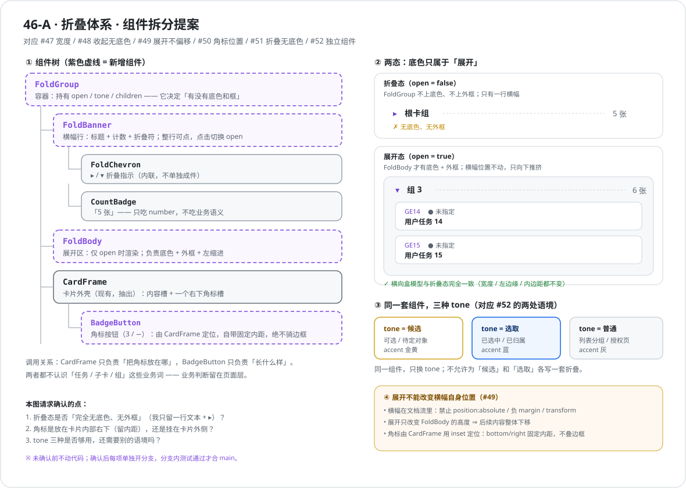
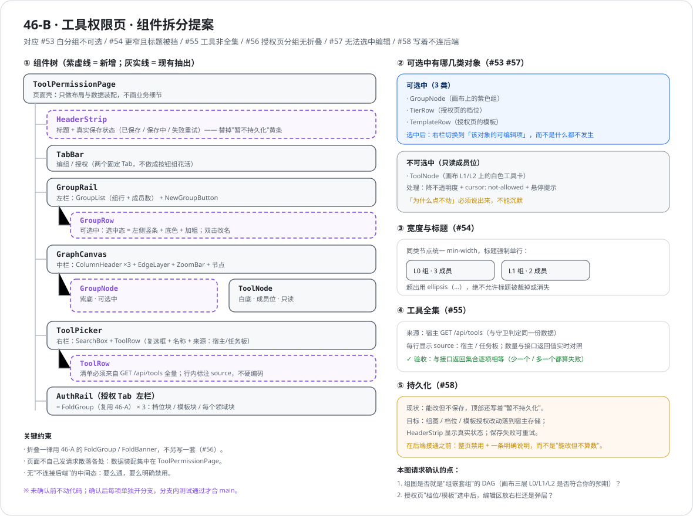
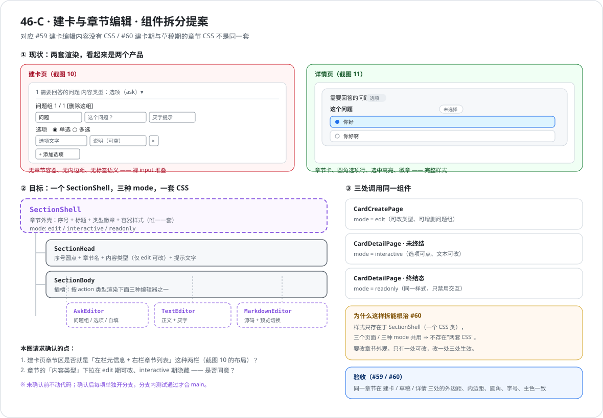
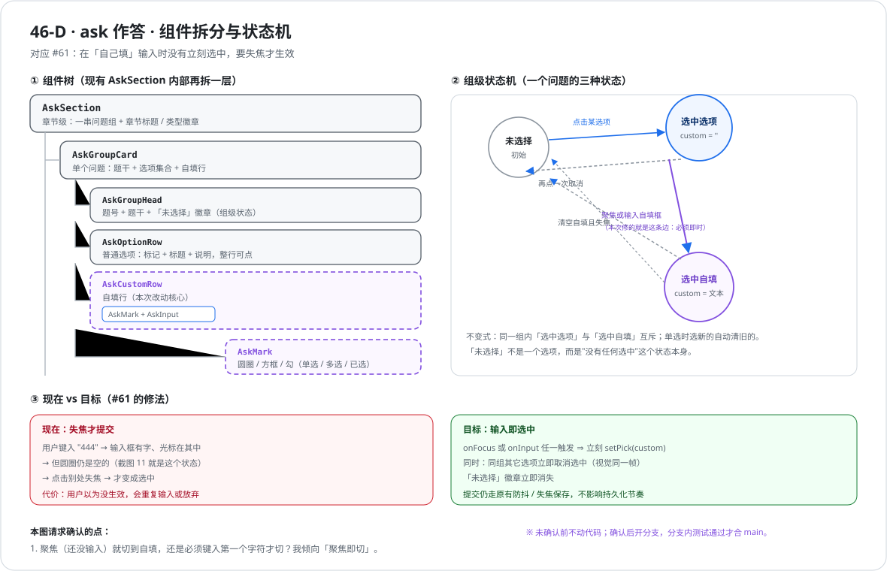
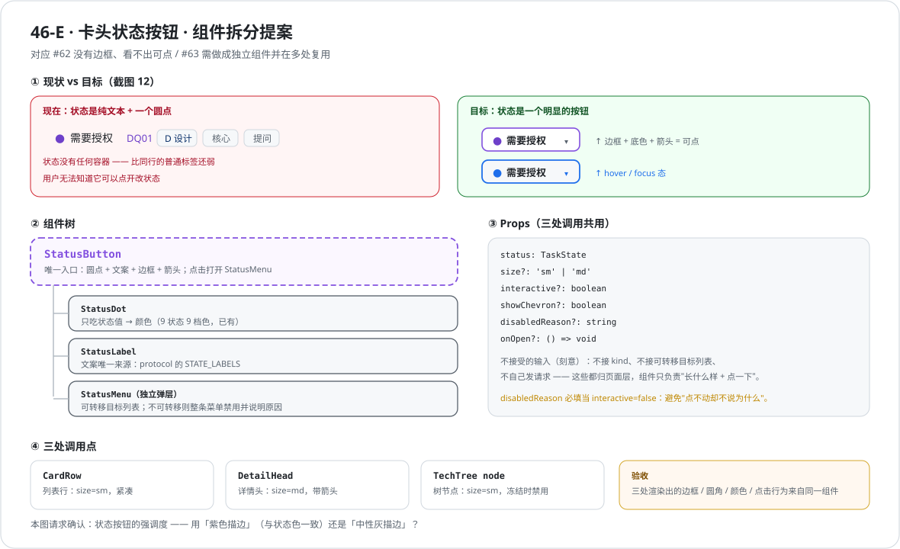

> 基线：tag [`ui46-design-2026-11-28`](https://github.com/zms9110750/taskboard3/tree/ui46-design-2026-11-28)
>
> 来源：Issue [#46](https://github.com/zms9110750/taskboard3/issues/46)（父 Issue [#9](https://github.com/zms9110750/taskboard3/issues/9)）

# #46 UI 设计讨论

这里是 **#46 的设计层讨论区**：只谈"组件怎么拆、长什么样、按什么规则"。

- **施工进度**在 Issue [#46](https://github.com/zms9110750/taskboard3/issues/46) 与子问题 [#47](https://github.com/zms9110750/taskboard3/issues/47)–[#63](https://github.com/zms9110750/taskboard3/issues/63) 跟踪
- **设计争议**在这里逐条回复（Issue 评论是平铺的，没法楼中楼）

每条建议都用「默认建议」的写法：**你只需要回"第几条不同意 + 为什么"**，没提到的就按默认执行。

---

## 一、六个待拍板项

### 1. 折叠态要不要去掉底色与外框？

- **现状**：折叠的组横幅仍有浅紫底色，外面还套一层虚线框（截图 2、5）
- **默认建议**：去掉。折叠态只有一行 `▸ 标题 ……… 5 张`，无底色、无外框、无内边距盒
- **展开态**：才出现容器底色 + 外框 + 左缩进，以此表达"这是一个装东西的盒子"
- 影响子问题：[#48](https://github.com/zms9110750/taskboard3/issues/48)、[#51](https://github.com/zms9110750/taskboard3/issues/51)

### 2. 卡片右下角的圆角标（`3` / `−`）放哪？

- **现状**：骑在卡片边框上，一半在内一半在外（截图 3、4）
- **默认建议**：放在**卡片内部右下角**，与边框留固定内距；不同尺寸卡片用同一套内距
- **备选**：挂在卡片外侧（需要为它预留画布空间，布局更复杂）
- 影响子问题：[#50](https://github.com/zms9110750/taskboard3/issues/50)

### 3. 折叠的配色（tone）要几种？

- **默认建议**：三种
  - **候选**（金黄）：可选 / 待定对象
  - **选取**（蓝）：已选中 / 已归属对象
  - **普通**（灰）：列表分组、授权页分组
- 这样同一套折叠组件能同时服务"候选"和"选取"两个语境（这是 [#52](https://github.com/zms9110750/taskboard3/issues/52) 的核心诉求）
- 你还想要别的语境吗？

### 4. 工具权限页两个问题

**4a 画布上的组嵌套是三层吗（L0 → L1 → L2）？**

- **默认建议**：是，就三层，每层横排；组可以含组、也可以含任意工具，只允许不成环

**4b 授权页点中一个档位/模板后，编辑区放哪？**

- **默认建议**：右侧栏（与左栏列表左右对照，不弹层）
- **备选**：弹层（画面更聚焦，但失去对照）
- 影响子问题：[#57](https://github.com/zms9110750/taskboard3/issues/57)

### 5. 建卡页是"左栏元信息 + 右栏章节列表"两栏吗？

- **现状**：截图 10 就是这么排的（左：标题/模板/父任务/关系/高级设置；右：章节编辑）
- **默认建议**：保持两栏，章节区换成与详情页同一套 `SectionShell` 样式
- 影响子问题：[#59](https://github.com/zms9110750/taskboard3/issues/59)、[#60](https://github.com/zms9110750/taskboard3/issues/60)

### 6. 卡头状态按钮的描边用什么颜色？

- **现状**：`● 需要授权` 是纯文本，没有边框（截图 12）
- **默认建议**：用**状态自身的颜色**做描边（"需要授权"紫、"成功"绿……），悬停时加深
- **备选**：中性灰描边（更克制，但状态辨识度低）
- 影响子问题：[#62](https://github.com/zms9110750/taskboard3/issues/62)、[#63](https://github.com/zms9110750/taskboard3/issues/63)

---

## 二、组件拆分图（五张）

### 46-A · 折叠体系

### 46-B · 工具权限页

### 46-C · 建卡与章节编辑

### 46-D · ask 作答状态机

### 46-E · 卡头状态按钮

> 图在 tag `ui46-design-2026-11-28` 下，与本文同版本；改图会重新打 tag 并在本讨论追加说明。

---

## 三、施工纪律（用户 2026-11-28 指令）

1. 每个问题一个子问题（已建 [#47](https://github.com/zms9110750/taskboard3/issues/47)–[#63](https://github.com/zms9110750/taskboard3/issues/63)）
2. 每个修正单独开分支，在分支里提 PR、在分支里跑测试
3. **只有在确认修好之后**才合并到 `main` 并关闭子问题
4. UI 一律组件化：每处 UI 的组件划分先出 SVG 给用户选，用户授意后才动工

---

## 四、本轮不需要讨论的事项（避免跑偏）

- 这些问题**不涉及**状态机语义、权限档位语义、卡关系语义 —— 那些归 #10–#15 的设计裁定
- 本文只解决**呈现与交互**：#46 列出的 17 条
